<table>
  <tr>
    <td align="center" valign="middle" width="40%">
      
    </td>
    <td valign="middle" width="60%">
      
    </td>
  </tr>
</table>

  

### CS Engineering Student | Full Stack Developer | AI/ML Enthusiast

*Learning • Building • Automating • Solving*

---

## 🚀 About Me

<table width="100%">
  <tr>
    <td width="52%" valign="top">

- 🎓 **Computer Science Engineering** student (Class of 2028, **CGPA 8.35**) at **V.S.B. College of Engineering Technical Campus**, Coimbatore, Tamil Nadu.
- 💻 Proficient in **Java, Python, C, C++**, and modern **Full-Stack Web Technologies**.
- 🤖 Completed AI &amp; Machine Learning internships with **TechSaksham (Microsoft &amp; SAP)** and **IBM SkillsBuild (AICTE / Edunet Foundation)**.
- 🧩 Built AI-driven and data-analytics applications including **AgriSmart**, **Personal Fitness Tracker**, **AI-Powered Study Buddy**, and **AI Meme Creator**.
- 🧠 Practicing **Data Structures &amp; Algorithms** across LeetCode, HackerRank, CodeChef, and GeeksforGeeks.
- 🗣️ Languages known: **English, Tamil, Telugu, Kannada, Hindi**.

    > "Work hard in silence, let your success be your noise."

    </td>
    <td width="48%" valign="middle" align="center">

    </td>
  </tr>
</table>

## ⚡ Tech Stack

  

<!-- SKILLS SHOWCASE -->
<h2>⚡ Tech Stack &amp; Engineering Arsenal</h2>

<table width="100%" align="center">
  <tr>
    <td width="50%" valign="top">
      <h3>💻 Programming Languages</h3>
      
        
      <h3>🎨 Frontend &amp; UI</h3>
      
        
      <h3>⚙️ Backend &amp; Desktop</h3>
      
      

        
        
      

       
      <h3>🧰 Developer Tools</h3>
      
    </td>
    <td width="50%" valign="top">
      <h3>🤖 AI, ML &amp; Data Analytics</h3>
      

        
        
        
        
        
         
        Calorie prediction models, generative AI tooling, local LLMs, and data-driven dashboards.
      

       
      <h3>🌐 Web Technologies</h3>
      
HTML5 • CSS3 • JavaScript (ES6) • TypeScript • Tailwind CSS • Chart.js • REST &amp; AI API Integration

       
      <h3>🛠️ Software Engineering</h3>
      
Object-Oriented Programming • Data Structures &amp; Algorithms • Python Automation • Problem Solving • Version Control

       
      <h3>🏆 Competitive Programming</h3>
      

        
        
        
      

    </td>
  </tr>
</table>

<h2>🚀 Featured Projects</h2>

<table width="100%">
  <tr>
    <td width="50%" valign="top">
      <h3>🌾 AgriSmart</h3>
      
Interactive agricultural analytics dashboard with AI-driven crop recommendations, Chart.js visualizations, voice commands &amp; TTS (EN/HI), and a floating chat assistant.

      

        <code>JavaScript</code> <code>Tailwind CSS</code>
        <code>Node.js</code> <code>AI APIs</code>
      

      

        🔗 <a href="https://github.com/GaganB982006Hello/Agri-Smart">Repository</a> •
        🌐 <a href="https://agri-smart-red.vercel.app">Live Demo</a>
      

    </td>
    <td width="50%" valign="top">
      <h3>🏋️ Personal Fitness Tracker</h3>
      
ML-powered web fitness tracker predicting calorie expenditure from user inputs (age, gender, BMI, heart rate, duration) for personalized health insights.

      

        <code>Python</code> <code>Machine Learning</code>
        <code>Streamlit</code> <code>Pandas</code> <code>NumPy</code>
      

      

        🔗 <a href="https://github.com/GaganB982006Hello/Personal_Fitness_Tracker">Repository</a> •
        🌐 <a href="https://personal-fitness-tracker-blush.vercel.app">Live Demo</a>
      

    </td>
  </tr>
  <tr>
    <td width="50%" valign="top">
      <h3>🎨 AI Meme Creator</h3>
      
Interactive AI-assisted meme and image editing studio featuring rich typography, blend modes, advanced image filters, and a stock asset library.

      

        <code>JavaScript</code> <code>HTML5</code>
        <code>CSS3</code> <code>AI/ML</code>
      

      

        🔗 <a href="https://github.com/GaganB982006Hello/Ai_Meam_Creater">Repository</a> •
        🌐 <a href="https://ai-meam-creater.vercel.app">Live Demo</a>
      

    </td>
    <td width="50%" valign="top">
      <h3>📚 AI-Powered Study Buddy</h3>
      
Intelligent study companion designed to help students organize concepts, revise effectively, and accelerate learning workflows with AI assistance.

      

        <code>TypeScript</code> <code>React</code>
        <code>AI</code> <code>Vercel</code>
      

      

        🔗 <a href="https://github.com/GaganB982006Hello/AI-Powered-Study-Buddy">Repository</a> •
        🌐 <a href="https://ai-powered-study-buddy-six.vercel.app">Live Demo</a>
      

    </td>
  </tr>
  <tr>
    <td width="50%" valign="top">
      <h3>📰 Fake News Detector for Students</h3>
      
Student-focused verification web tool that analyzes news claims and helps learners identify misinformation quickly.

      

        <code>JavaScript</code> <code>HTML5</code>
        <code>CSS3</code> <code>AI</code>
      

      

        🔗 <a href="https://github.com/GaganB982006Hello/Fake_News_Detector_for_Students">Repository</a> •
        🌐 <a href="https://fakenewsdetectorforstudents.vercel.app">Live Demo</a>
      

    </td>
    <td width="50%" valign="top">
      <h3>⚙️ File Automation Toolkit</h3>
      
Collection of 5 Python automation scripts for file organization, email sorting, PDF merging, and web scraping to eliminate repetitive workflows.

      

        <code>Python</code> <code>Automation</code>
        <code>Scripting</code> <code>PDF</code>
      

      

        🔗 <a href="https://github.com/GaganB982006Hello/File_AutomationPy">Repository</a> •
        🌐 <a href="https://file-automation-py.vercel.app">Live Demo</a>
      

    </td>
  </tr>
  <tr>
    <td width="50%" valign="top">
      <h3>🎓 Smart Education (Aurora Edu Hub)</h3>
      
Intuitive educational platform enabling students and educators to manage learning content, collaborate, and use interactive study tools.

      

        <code>TypeScript</code> <code>React</code>
        <code>Web App</code>
      

      

        🔗 <a href="https://github.com/GaganB982006Hello/Smart-Education">Repository</a> •
        🌐 <a href="https://aurora-edu-hub.lovable.app/">Live Demo</a>
      

    </td>
    <td width="50%" valign="top">
      <h3>🗺️ V2XMap</h3>
      
Interactive mapping and visualization web application built with modern JavaScript and deployed on Vercel.

      

        <code>JavaScript</code> <code>Maps</code>
        <code>Web App</code>
      

      

        🔗 <a href="https://github.com/GaganB982006Hello/V2XMap">Repository</a> •
        🌐 <a href="https://v2-x-map.vercel.app">Live Demo</a>
      

    </td>
  </tr>
  <tr>
    <td width="50%" valign="top">
      <h3>🤖 AIVOA</h3>
      
Modern AI-driven web experience built with JavaScript and deployed seamlessly for fast, responsive interaction.

      

        <code>JavaScript</code> <code>AI</code>
        <code>Web App</code>
      

      

        🔗 <a href="https://github.com/GaganB982006Hello/AIVOA">Repository</a> •
        🌐 <a href="https://aivoa-black.vercel.app">Live Demo</a>
      

    </td>
    <td width="50%" valign="top">
      <h3>🌐 Personal Portfolio Website</h3>
      
Responsive portfolio showcasing education, internships, certifications, interactive SVG animations, and live GitHub &amp; LeetCode heatmaps.

      

        <code>HTML5</code> <code>CSS3</code>
        <code>JavaScript</code> <code>REST APIs</code>
      

      

        🔗 <a href="https://github.com/GaganB982006Hello/GaganB">Repository</a> •
        🌐 <a href="https://gagan-b.vercel.app/">Live Site</a>
      

    </td>
  </tr>
</table>

## 🚀 Experience, Education &amp; Certifications

I focus on building practical software solutions that combine **clean code, responsive user experiences, machine learning, and automated workflows**. My journey spans AI/ML internships, full-stack web apps, and competitive problem-solving.

<table width="100%">
  <tr>
    <td width="50%" valign="top">
      <h3>💼 Internships</h3>
      <ul>
        <li><strong>TechSaksham (Microsoft &amp; SAP CSR)</strong> — AI &amp; ML Intern via Edunet Foundation (Feb–Mar 2025, 6 weeks). Built the <a href="https://personal-fitness-tracker-blush.vercel.app">Personal Fitness Tracker</a> ML app.</li>
        <li><strong>IBM &amp; SkillsBuild (AICTE)</strong> — AI &amp; ML Intern via Edunet Foundation (Jan–Feb 2026, 6 weeks). Built <a href="https://ai-meam-creater.vercel.app">AI Meme Creator</a>.</li>
      </ul>
      <h3>🎓 Education</h3>
      <ul>
        <li><strong>B.E. Computer Science Engineering</strong> — <a href="https://vsbcetc.edu.in/">V.S.B. College of Engineering Technical Campus</a>, Coimbatore (CGPA: <strong>8.35</strong>, Class of 2028).</li>
        <li><strong>Higher Secondary (MPC / CS)</strong> — Sri Vijay Vidyalaya, Hosur (<strong>81.33%</strong>).</li>
      </ul>
    </td>
    <td width="50%" valign="top">
      <h3>📜 Certifications</h3>
      <ul>
        <li><a href="https://certificate.hack2skill.com/user/genai14/2025H2S04GENAI-A1400048">Gen AI ExChange Program</a> — Hack2Skill</li>
        <li><a href="https://www.hackerrank.com/certificates/iframe/123f45cc4f7f">Software Engineer Certificate</a> — HackerRank</li>
        <li><a href="https://www.linkedin.com/learning/certificates/037b71ffb71097eeda3e09038ca5daa7e5f076b910a1d1dcdda7240686a8c3ad">Career Essentials in GitHub</a> — GitHub &amp; LinkedIn Learning</li>
        <li><a href="https://www.coursera.org/account/accomplishments/records/P58WOE125IFK">Beginning Llamafile for Local LLMs</a> — Duke University</li>
        <li><a href="https://www.infyspringboard.com/certificates/JAVA_FEATURES">Java Features</a> — Infosys Springboard</li>
      </ul>
    </td>
  </tr>
  <tr>
    <td width="50%" valign="top">
      <h3>🤖 AI, ML &amp; Data Analytics</h3>
      <ul>
        <li>Building predictive ML models with Python, Pandas, NumPy, and Streamlit</li>
        <li>Integrating generative AI &amp; LLM workflows into interactive web apps</li>
        <li>Designing data visualizations and real-time analytics dashboards</li>
        <li>Exploring local LLMs and intelligent student productivity tools</li>
      </ul>
    </td>
    <td width="50%" valign="top">
      <h3>🧩 Problem Solving &amp; Engineering</h3>
      <ul>
        <li>Practicing DSA and POTD challenges across LeetCode, GeeksforGeeks &amp; Codeforces</li>
        <li>Writing Python automation scripts to eliminate repetitive daily tasks</li>
        <li>Building responsive, accessible interfaces with HTML, CSS, Tailwind &amp; JS/TS</li>
        <li>Collaborating on full-stack projects with Git &amp; GitHub workflows</li>
      </ul>
    </td>
  </tr>
</table>

### 🧠 Engineering Principles

- **Problem-solving first:** Understand the problem deeply before writing code.
- **Practical impact:** Build tools that solve real-world challenges in agriculture, health, and education.
- **Clean &amp; modular code:** Prefer readable, maintainable structures across Java, Python, and JavaScript.
- **Continuous learning:** Strengthen DSA, full-stack architecture, and AI engineering through daily practice.

### 🎯 Current Focus

- Building full-stack &amp; AI-powered web applications
- Strengthening Data Structures &amp; Algorithms in Java and Python
- Exploring local LLMs, AI agents, and intelligent automation
- Expanding hands-on ML &amp; data analytics projects

> *My goal is to turn complex logic into reliable, user-friendly software through continuous learning and hands-on engineering.*

## 📊 GitHub Analytics

  
  

  

  

### 🐍 Contribution Snake
<picture>
  <source media="(prefers-color-scheme: dark)" srcset="https://raw.githubusercontent.com/GaganB982006Hello/GaganB982006Hello/output/github-contribution-grid-snake-dark.svg">
  <source media="(prefers-color-scheme: light)" srcset="https://raw.githubusercontent.com/GaganB982006Hello/GaganB982006Hello/output/github-contribution-grid-snake.svg">
  
</picture>

## 🤝 Connect With Me

  
  
  
  
  
  
  
  
  
  

<i>Thanks for visiting my profile! Explore my repositories and portfolio as I keep learning and building. ⭐</i>

